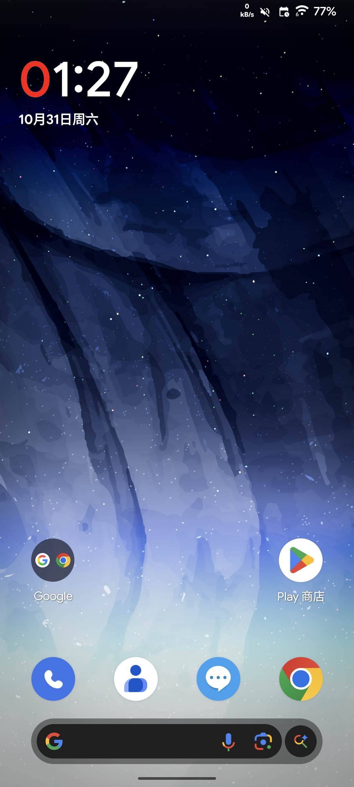
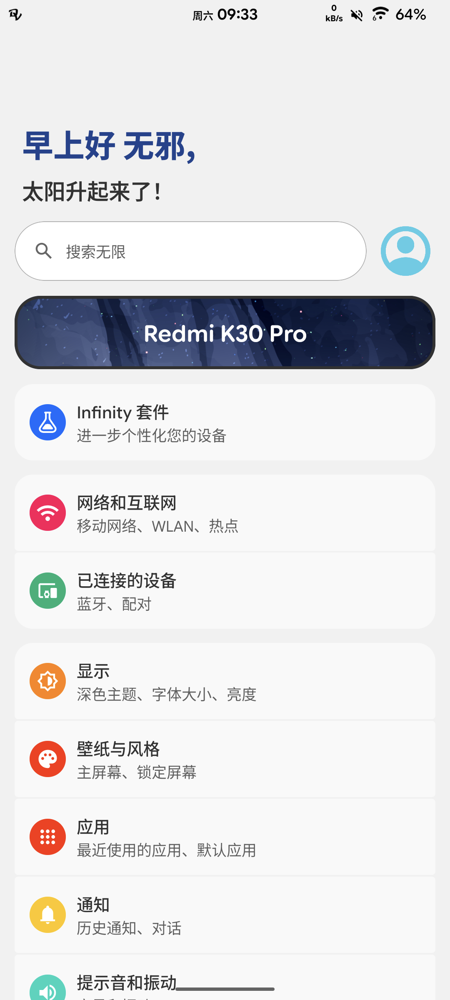
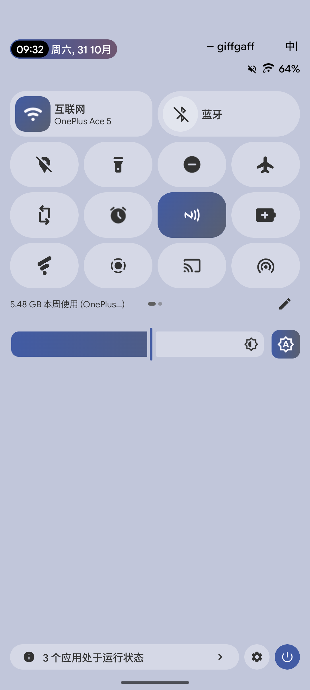
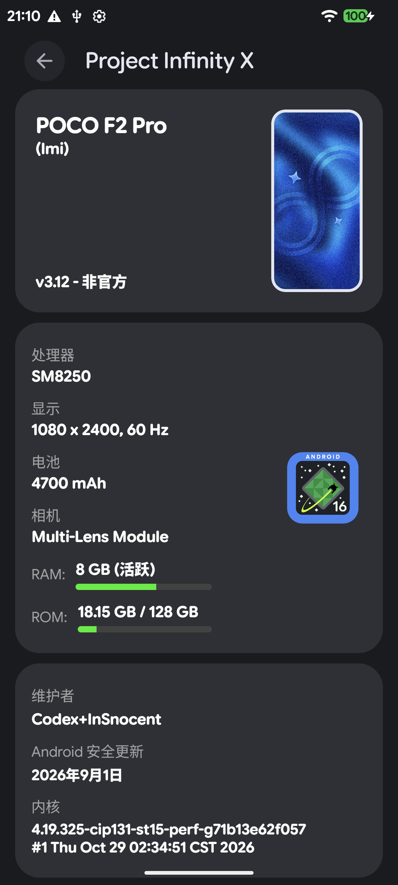
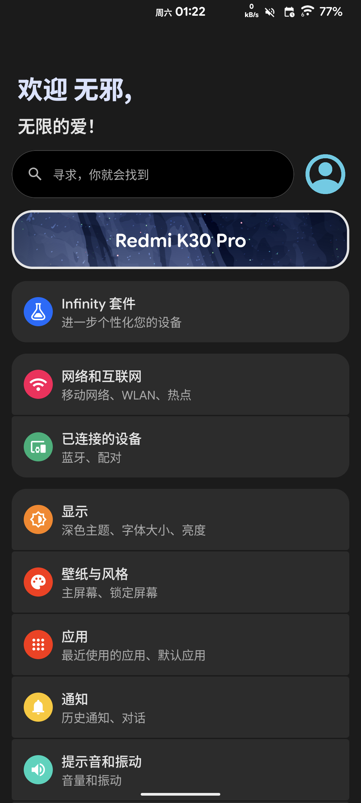
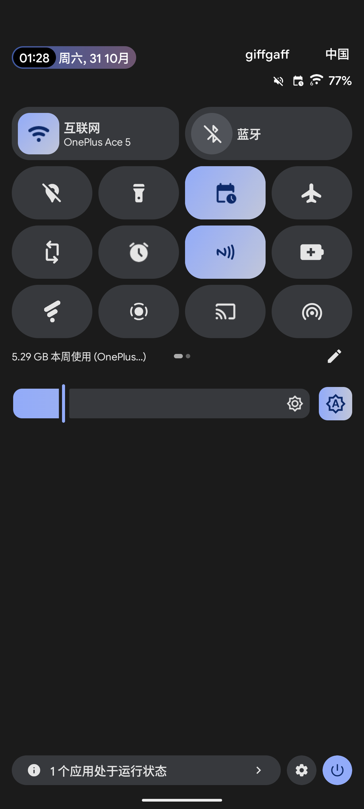

# Project Infinity-X 3.12 / Android 16 — lmi

简体中文 | [English](docs/README_EN.md)

Redmi K30 Pro（代号 lmi）的 Project Infinity-X 非官方构建、复现资料与可选 SukiSU Ultra boot，供参考。

---
### 截图展示

| | | |
|--|--|--|
||||
||||

---
## 说明

- [源码和构建](docs/BUILD.zh-CN.md)
- [测试范围与已知问题](docs/STATUS.zh-CN.md)
- [版本说明](RELEASE-NOTES.zh-CN.md)
- [隐私扫描范围与限制](PRIVACY-AUDIT.json)
- ROM 下载：
  - [SourceForce](https://sourceforge.net/projects/lmi-infinityx-a16-unofficial/)
  - [MEGA](https://mega.nz/file/MpRRAbQZ#m8YWwipUbB9SgZYBAJYTBfFywAgBH5bQXrIK2YnE_FE)
  - 夸克网盘（暂无）

下载完整 ROM 后先校验 SHA-256，再执行 ADB sideload。若使用分卷，须先合并。
原 ROM 的签名和字节内容保持不变。

~~~sh
# Windows
certutil -hashfile Project_Infinity-X-3.12-lmi-29.10.2026-GAPPS-UNOFFICIAL.zip SHA256
# Linux / macOS
sha256sum Project_Infinity-X-3.12-lmi-29.10.2026-GAPPS-UNOFFICIAL.zip
~~~

完整 ROM 的 SHA-256 必须为
`9cf66b7fa39e1f5afd2b22dfdb13739bbba6140c9456ab659e1df2434933843e`；
其余文件的哈希见 [SHA256SUMS.txt](SHA256SUMS.txt)。

若网盘只提供 `.partNN` 分卷，取得全部分卷和 release-manifest.json 后合并（Python 3）：

~~~sh
python scripts/assemble-rom.py --directory /path/to/downloads
~~~

不要把分卷或源码归档直接用于 ADB sideload。

| 项目 | 值 |
|---|---|
| ROM | Infinity-X 3.12 / Android 16 / GAPPS / UNOFFICIAL |
| 构建日期 | 2026-10-29 |
| 测试设备 | 国行 Redmi K30 Pro，lmi |
| 内核 | 4.19.325-cip131-st15-perf-g71b13e62f057 |
| 构建类型 | userdebug |
| 可选 Root | SukiSU Ultra builtin，驱动版本 41100 |
| KPM / SUSFS | 关闭 |
| SELinux | 本机观测为 Enforcing |

刷机包默认不含 SukiSU。可选 root boot 只适用于这一版 ROM，不适用于其他 ROM 或后续版本。

主要设备树、内核和 vendor 基础来自 LineageOS、TheMuppets；
ROM 来自 Project Infinity-X，Root 来自 SukiSU-Ultra / KernelSU。
固定来源、补丁和许可证见 SOURCES.json、NOTICE、LICENSES。

## 如何使用

### 准备
- 设备代号必须为 lmi（Redmi K30 Pro）。Redmi K30、K30 Ultra 等其他机型不适用；
  POCO F2 Pro 同为 lmi，但本项目未独立实测
- 解锁Bootloader
- 底包：国行 MIUI V14.0.5.0.SJKCNXM
- 从网盘下载完整 ROM 和配套 recovery.img
- 如需root，可选 Release 的 SukiSU Ultra 构建
- Google 官方 Platform-Tools（或传统的fastboot、adb）
- 刷机前自行备份个人数据、聊天和照片
- 确保电量充足，USB 连接稳定

### 从其他 ROM 首次安装

以下会清除手机用户数据。请先完成备份。

1. 在 Fastboot 模式核对机型代号为 lmi。
2. 使用同一版本分发文件 配套 recovery.img：

~~~sh
fastboot getvar product
fastboot flash recovery recovery.img
fastboot reboot recovery
~~~

若设备不支持后一条重启命令，使用按键进入 Recovery。
配套 Recovery 是此 ROM 编译出的 AOSP/Lineage 衍生 Recovery。
本项目没有验证旧第三方 Recovery 对 Android 16 的解密与安装兼容性。

3. 在 Recovery 选择 ``Factory reset`` → ``Format data/factory reset``，
   确认 ``Data wipe complete``。
4. 选择 ``Apply update`` → ``Apply from ADB``，然后运行：

~~~sh
adb sideload Project_Infinity-X-3.12-lmi-29.10.2026-GAPPS-UNOFFICIAL.zip
~~~

5. 确认 Recovery 报告安装成功，再重启系统。
   ADB 进度停在约 47% 后成功结束可能是正常表现，以手机端结果为准。

ROM 安装器已写入 boot、dtbo、vbmeta、vbmeta_system 和动态分区内容，
不需要额外手动刷写这些镜像；不要自行套用其他机型的刷机命令。
不要重新锁定 Bootloader。

### 可选 Root（SukiSU Ultra）

先确认系统已能正常启动；切换 boot 不需要格式化数据。

~~~sh
fastboot flash boot boot-lmi-infinityx-sukisu-v4.3.0.img
fastboot reboot
~~~

管理器从[官方 Release](https://github.com/SukiSU-Ultra/SukiSU-Ultra/releases/tag/v4.3.0) 获取，本仓库不重新打包；不要同时刷入另一套 Magisk Root。
KPM、SUSFS、KSU 调试模式关闭，SELinux 本机观测为 Enforcing；
第三方模块、Zygisk/Xposed 组合未验证。
内核与驱动的重建步骤、ABI 校验方法见 [源码和构建](docs/BUILD.zh-CN.md)、
patches/ 与 configs/。

### 可能存在的问题
- 顶部指示灯曾暂时完全不亮，之后恢复充电常亮；原因未定位，
  通知呼吸/闪烁行为尚未专门确认。
- NFC、蓝牙配对、GPS、VoLTE/VoWiFi、待机耗电和长期稳定性未完整测试。
- POCO F2 Pro 和其他地区变体未独立实测。
- 不保证 Play Integrity、支付/银行、DRM 或游戏环境检查结果。
- 本仓库没有自己的自动 OTA 服务，后续版本需按对应说明手动更新。

## 免责声明

- 本项目是个人维护、AI 辅助的社区 UNOFFICIAL 构建，与小米 / Redmi、Google、
  Project Infinity-X、LineageOS、TheMuppets、SukiSU-Ultra / KernelSU
  均无隶属关系，未获其授权或背书；相关名称与商标归各自所有者。
- 刷机属于高风险操作：可能变砖、丢失数据、损坏硬件、失去保修，
  并可能触发 Play Integrity、银行/支付、DRM 或游戏环境校验失败。
- 请在了解上述风险后自行决定是否使用。因下载、刷写、使用或无法使用本构建
  造成的任何数据丢失、设备损坏、账号受限、保修失效或其他直接、间接损失，
  由操作者自行承担；本项目及其贡献者不对可用性、安全性、完整性或特定用途
  适用性作任何担保，也不承担赔偿责任。具体条款见 LICENSE 第 7、8 条。
- 不建议用于工作机、企业设备或依赖支付/身份验证的场合。
- 请遵守设备、软件及所在地区的法律与许可条款。上述限制在适用法律允许的
  范围内生效；若当地法律不允许排除默示担保，以法律要求为准。
- 当无影响使用的恶性BUG的情况下，本项目大概率为最终构建。

## 许可协议

| 内容 | 许可 |
|---|---|
| 文档与辅助脚本（scripts/、reproduction/） | Apache-2.0，见 LICENSE |
| Linux 内核、SukiSU / KernelSU 驱动及其补丁 | GPL-2.0，见 LICENSES/GPL-2.0.txt；对应源码随版本提供 |
| 上游设备树、vendor 与 ROM 平台补丁 | 保留各自上游许可与 SPDX 版权头 |
| 预编译 ROM、recovery、boot 与厂商闭源组件 | 不因本仓库重新许可 |

- 复制、修改或再分发本仓库内容时，须保留 NOTICE 与上游署名、标明修改，
  并附上 Apache-2.0 许可副本；GPL-2.0 部分须按其条款提供对应源码。
- ROM 中的 AOSP 组件、Google 应用（GAPPS）和厂商闭源二进制分别受其自身
  许可与条款约束，本仓库不授予任何额外权利；如权利人提出要求，
  相关下载会被移除。
- 不得暗示本构建是上游官方发布或获得上游背书。
- 逐项来源、固定提交与补丁见 SOURCES.json、NOTICE 和 manifests/pinned.xml。

## 致谢

本构建基于以下上游项目的工作：

- [Project Infinity-X](https://github.com/ProjectInfinity-X)：ROM 平台与构建系统
- [LineageOS](https://github.com/LineageOS)：lmi / sm8250 设备树、Xiaomi 硬件支持与内核
- [TheMuppets](https://github.com/TheMuppets)：构建所需的 vendor 仓库
- [SukiSU-Ultra](https://github.com/SukiSU-Ultra/SukiSU-Ultra) 与 [KernelSU](https://github.com/tiann/KernelSU)：可选 Root 实现
- [AOSP](https://source.android.com) 与 [Linux 内核](https://www.kernel.org) 贡献者：Android 与内核基础

也感谢所有上游贡献者和设备维护者。各名称与商标归其所有者。
